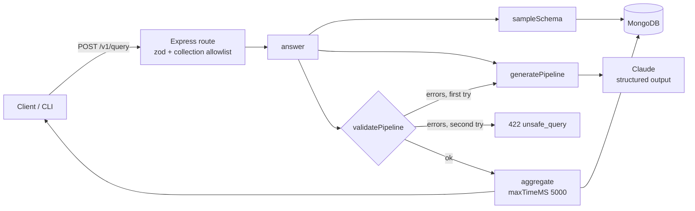

# nl-to-mongo-query

Ask MongoDB questions in plain English: Claude writes an aggregation pipeline, a safety validator vets it, and one self-repair round fixes what the validator rejects.

[](https://github.com/Muhaman/nl-to-mongo-query/actions/workflows/ci.yml)

## What it does

- Samples the target collection to learn its field paths, types and example values.
- Asks Claude for an aggregation pipeline (structured output: `pipelineJson` + `explanation`).
- Validates the pipeline before anything touches the database: stage allowlist, operator denylist at any depth (including `$lookup` sub-pipelines), `$lookup` limited to allowlisted collections, `$limit` clamped to 100.
- If the pipeline is unparseable, rejected, or MongoDB refuses to run it, feeds the errors back to the model once. Still failing: HTTP 422 `unsafe_query` with the validator errors.
- Executes with `maxTimeMS: 5000` and returns the pipeline, explanation, results and attempt count.

The bundled dataset, `data/movies.json`, is **synthetic**: 200 generated films with made-up titles and people and invented box-office figures. Nothing in it is real.

## Architecture



## Quickstart

```bash
cp .env.example .env            # set ANTHROPIC_API_KEY
docker compose up --build       # mongo + seed + app on :3000
```

Without Docker (Node 24, a MongoDB on `localhost:27017`):

```bash
npm install
npm run seed                    # loads the synthetic movies
npm run dev
```

Configuration (`.env.example`): `ANTHROPIC_API_KEY`, `ANTHROPIC_MODEL` (default `claude-opus-5-5`), `MONGODB_URI`, `MONGODB_DB` (default `movies`), `ALLOWED_COLLECTIONS` (default `movies`), `PORT`, `CORS_ORIGINS`, `LOG_LEVEL`. Missing required variables fail at startup, naming the variable.

## Usage

```bash
curl -s localhost:3000/v1/query \
  -H 'content-type: application/json' \
  -d '{"question": "Which five movies have the highest box office?", "collection": "movies"}'
```

Response (shape):

```json
{
  "pipeline": [{ "$sort": { "boxOffice": -1 } }, { "$limit": 5 }, { "$project": { "title": 1, "boxOffice": 1 } }, { "$limit": 100 }],
  "explanation": "…",
  "results": [],
  "attempts": 1
}
```

| Status | `error.code` | When |
|---|---|---|
| 400 | `invalid_request` | question not 3 to 500 characters, malformed body |
| 400 | `collection_not_allowed` | collection not in `ALLOWED_COLLECTIONS` |
| 422 | `unsafe_query` | both attempts rejected; `error.details` lists the validator errors |
| 502 | `refusal` / `max_tokens` / `invalid_model_output` | the model declined, was cut off, or replied unreadably |

There is also `GET /healthz`, and a CLI: `npm run cli -- "How many movies are longer than 150 minutes?"`.

## Design decisions & trade-offs

- **Allowlist, not blocklist, for stages.** Anything not on the list (`$facet`, `$unionWith`, `$graphLookup`, `$out`, `$merge`, ...) is an error. The operator denylist (`$where`, `$function`, `$accumulator`, `$out`, `$merge`) is then enforced at every depth, including inside `$lookup.pipeline`, because those can hide in `$expr` and sub-pipelines.
- **The pipeline is a JSON string in the structured output.** Aggregation stages are open-ended, which strict JSON schemas cannot express, so the schema is `{pipelineJson, explanation}` and the server parses and validates the string itself.
- **The validator owns the limit.** Every `$limit` is clamped to 100, and a `$limit` is appended whenever the pipeline does not end with one, so a trailing `$unwind` cannot fan out an unbounded result.
- **One repair round.** A second attempt with the exact errors fixes most mistakes; more rounds mostly add latency and cost. Errors from MongoDB itself (for example an unknown operator) count as repairable.
- **Read-only by construction, not by trust.** Validation is the safety layer, but the connection should still use a MongoDB user with read-only privileges.
- **Claude calls.** `output_config.effort` is `medium`, with server-side refusal fallback where the model supports it. A `refusal` or `max_tokens` stop reason becomes a typed 502 rather than an empty 200.

## Testing

```bash
npm test          # vitest; mongodb-memory-server downloads mongod on first run
npm run lint && npm run typecheck
```

Covers the validator (nested `$where`/`$function`, `$out`, `$merge`, `$lookup` allowlist and sub-pipelines, non-allowlisted stages, limit append and clamp), schema sampling, the service (repair loop, prompt contains the first errors, unparseable JSON, execution errors) and routes (422 shape, 400s, 502 refusal) with a fake LLM, plus env validation.

### Results

`eval/questions.json` holds 20 questions with hand-written reference pipelines. The runner executes both pipelines and compares result sets (order-insensitive unless the reference has a `$sort`), then prints accuracy. It calls the live API, so it is run on demand:

```bash
npm run seed
npm run eval
```

No accuracy figure is published here; run it against your model of choice.

## Limitations & next steps

- Schema comes from a 50-document sample, so rare fields can be missed; it is re-sampled on every request.
- Only collections in `ALLOWED_COLLECTIONS` are queryable; there is no per-field access control.
- The validator limits what runs, not how expensive it is: `maxTimeMS` and the limit cap the damage, but an index-less `$group` is still allowed.
- The eval compares exact result sets, so a correct answer with different field names counts as a miss; the questions name their output fields to keep this fair.
- Next: schema caching, read-only role in the compose file, conversational follow-ups.

## License

MIT
